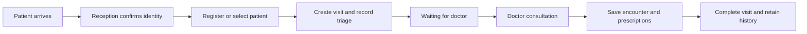

# Software requirements specification

## Purpose and implementation baseline

The application is an internal clinic workspace for a walk-in patient's journey from reception and triage to a doctor's consultation, prescriptions, and medical history. Scheduled appointments share the same encounter workflow after arrival.

This specification distinguishes the intended system from the current demo. The repository contains a React frontend, an initial PostgreSQL schema, and a Docker Compose development stack. The backend is a placeholder. The frontend uses browser `localStorage`; it does not call PostgreSQL, Redis, or an API. The displayed doctor identity is sample content, not an authenticated session.

“Demo” below means a local browser behavior; “schema” means a database representation or constraint tested directly in PostgreSQL; “planned” means acceptance work remains. Passing the automated suite establishes the behaviors it exercises, not completion of the intended EHR.

## Scope and assumptions

- One clinic and one configured doctor are sufficient for the current demo. The database represents multiple staff members and clinicians.
- A walk-in can be a new patient or a returning patient. Registration creates a patient identity; arrival creates a separate visit. Booking alone does not create a completed encounter.
- Clinic local date determines appointment display and daily queue validity. The future server must configure a clinic timezone; the demo uses the browser's local timezone.
- Patient contact details are optional during registration. Self check-in requires a name and phone number so reception can identify the arrival.
- Allergy status is explicitly `unknown`, `none`, or `known`. Missing confirmation must never become “no known allergies.”
- This scope covers reception, triage, scheduling, consultation, chart history, and printable prescription drafts. Billing, inventory, laboratory integration, insurance, telemedicine, and electronic pharmacy transmission are outside the initial scope.
- All current fixtures and test records are synthetic. Production use requires the planned access controls, shared persistence, audit, backup, and operational acceptance below. No regulatory compliance is claimed.

## Actors and intended access

| Actor | Intended responsibilities | Restrictions |
| --- | --- | --- |
| Patient / accompanying person | Submit limited daily self check-in information and receive a ticket. | No staff workspace, other patients, chart, or prescription access. A queue token is not staff authentication. |
| Attendant / secretary (`attendant_secretary`) | Find or register patients, confirm demographics and allergy status, book appointments, check arrivals in, record triage, and hand patients to the doctor. | Cannot author diagnoses or prescriptions, finalize clinical encounters, or read the doctor's full longitudinal history. |
| Doctor / administrator (`admin_doctor`) | Review triage and history, start consultation, document assessment, prescribe, complete visits, and manage staff access. | Every action is attributed to the authenticated user; disabled accounts cannot act. |

The role enum exists in the schema. Login, API authorization, staff administration, and enforcement of this table remain planned. Hiding a frontend button is insufficient authorization.

## Intended clinic workflow

1. **Arrival and identity check.** Reception searches name, patient number, or contact details before registering a new patient. A QR ticket is an arrival request; reception confirms identity and links it to a patient instead of automatically creating a medical chart from a name and phone number.
2. **Registration or confirmation.** Record name, date of birth, sex, optional contacts, and explicit allergy status. Known allergies require details. Returning patients retain the same patient number.
3. **Encounter creation.** Create one visit for this arrival. A scheduled arrival references its appointment; a walk-in can have no appointment. Retrying appointment check-in must not create another visit.
4. **Attendant triage.** Record chief complaint, initial notes, and available blood pressure, weight, and temperature. Missing observations remain missing. Confirm the patient and allergy information before placing the visit in the doctor's waiting queue.
5. **Doctor handoff.** The doctor sees waiting patients in arrival order, reviews the patient's identity, allergy status, triage, and authorized history, then starts the consultation. A deliberate reordering requires an attributed reason in the future API.
6. **Consultation and prescription.** Save interview notes, observed signs, reported symptoms, assessment, and treatment instructions. The doctor can create a prescription attached to the same visit. Review patient identity and allergy information before printing.
7. **Completion and follow-up.** Finalize the encounter, record completion time, update the linked appointment, and place a snapshot of the encounter and its prescriptions in history. Book follow-up if needed. Later draft edits must not alter the saved history.
8. **Exceptions.** Reception can pause new check-ins while continuing the existing line. Invalid, expired, or paused links cannot add tickets. Cancelled visits and no-shows remain distinguishable from completed care.

The demo currently implements registration/chart editing and an independent queue preview. Its “Start visit” button opens documentation; “Mark seen” completes a queue ticket. Neither operation implements the complete visit handoff or updates appointment status.

## Lifecycles

| Entity | Intended states and rules | Current representation |
| --- | --- | --- |
| Visit | `in_triage → waiting → in_progress → completed`; cancellation before completion. Terminal records remain in history. Queue, start, and completion timestamps correspond to actual events. | Schema has these states and timestamp fields. No API or UI transition service yet. |
| Appointment | `scheduled → confirmed → checked_in → completed`; cancellation before completion; `no_show` for a missed appointment. A scheduled appointment can be checked in directly. | Demo can create and display appointments. Schema additionally supports `no_show`. Status mutation and visit synchronization are planned. |
| Demo queue ticket | `waiting → called → completed`; at most one ticket is called in the single-doctor demo. Pausing intake does not remove existing tickets. | Browser-only queue; ticket has no patient ID, appointment ID, triage, or clinical record. |
| Daily queue session | New daily token, open or paused; a previous day's session is unavailable. Token rotation invalidates old links while preserving today's tickets. | Browser-local session. Shared server, atomic allocation, and automatic cross-device updates are planned. |

The schema's permitted status values do not themselves enforce every transition, staff role, or cross-entity update. The future API must validate and commit these changes atomically.

## Functional requirements

| ID | Requirement and acceptance condition | Implementation status |
| --- | --- | --- |
| PAT-01 | Search existing patients by case-insensitive name, patient number, or phone before creating a chart; opening a result shows that patient's identity and records. | Demo directory/global search. Duplicate-identity reconciliation is planned. |
| PAT-02 | Register a patient with a nonblank name, valid date of birth no later than today, sex, and explicit allergy status. Contacts are optional; entered email must be syntactically valid. Reject invalid input without creating a chart. | Demo validation; schema represents required demographics. Server validation is planned. |
| PAT-03 | Generate a stable, unique patient ID and human-readable patient number. Reopening a saved chart preserves identity. A cancelled registration creates nothing. | Demo identity/local persistence; schema enforces unique patient number. Shared allocation is planned. |
| ALL-01 | Keep `unknown`, `none`, and `known` distinct. `known` requires nonempty details; `unknown` and `none` carry no allergy list. Display status in the chart and prescribing context. | Demo; schema validates status/list cardinality. Server validation of each allergy entry is planned. |
| APT-01 | Book an existing patient with a date, start time, positive duration, reason, clinician, and initial `scheduled` status. Starting from a chart selects that patient. | Demo, with one sample clinician; schema links patient and clinician. |
| APT-02 | Reject overlap for the same clinician while an appointment is scheduled, confirmed, or checked in. Use half-open intervals: an appointment may start exactly when another ends. Cancelled and completed slots do not block booking. | Demo overlap check and schema exclusion constraint; concurrent booking API is planned. |
| APT-03 | Show appointments for a selected work week or day in local time and open the corresponding patient chart. Preserve existing bookings after validation errors. | Demo. |
| APT-04 | Check an appointment in once, create its visit, and synchronize completion/cancellation without changing another patient's encounter. Reject appointment/visit patient mismatch. | Schema enforces one visit per appointment and matching patient; API and UI workflow are planned. |
| QUE-01 | Generate today's QR/link and allow intake to pause or reopen. Reject stale-date, unknown-token, and paused check-ins. Regeneration preserves today's entries and invalidates the earlier token. | Demo browser-local session. |
| QUE-02 | Validate a nonblank name and a phone containing a digit. Repeating an active check-in with equivalent name casing and phone formatting returns the existing ticket. Issue monotonically ordered, zero-padded tickets for new arrivals. | Demo; server idempotency, identity verification, and concurrent allocation are planned. |
| QUE-03 | Call waiting tickets, allow at most one called ticket for the sample doctor, then mark the called ticket completed. Preserve tickets while intake is paused. | Demo. A queue ticket is not a completed medical encounter. |
| TRI-01 | Record available triage observations, complaint, and initial notes on the identified visit; reject nonpositive weight and temperature outside the schema's configured `25–45 °C` storage range. Queue the visit only after explicit handoff. | Schema fields and numeric constraints; attendant UI and API are planned. This storage range is not clinical advice. |
| VIS-01 | Retain saved interview drafts under their patient. Switching patients must not transfer unsaved signs, symptoms, prescription fields, or print previews to the other chart. | Demo clears transient form state on patient change; durable encounter-wide and cross-device drafts are planned. |
| VIS-02 | Save a nonempty encounter summary containing the interview-note snapshot, signs, symptoms, and diagnosis entered by the user. Reject a completely blank summary; later draft edits preserve the earlier saved content. | Demo summary/history; structured visits, authorship, and finalization are planned. |
| VIS-03 | A doctor starts and completes a visit with consistent queue/start/completion times; completed visits appear in that patient's longitudinal history with their prescriptions. Completion and linked appointment updates are one transaction. | Schema validates required/ordered timestamps and provides a completed-history view; API lifecycle and UI are planned. |
| RX-01 | Add a prescription to the selected patient's chart; a medication name is required. Preserve entered strength, directions, duration, and notes. Print the selected patient's selected prescription. | Demo. The schema attaches prescriptions to visits and doctors; integration is planned. |
| RX-02 | Only an authorized doctor can issue/finalize a prescription, linked to the correct encounter and author. Clinician review is required; no automatic medication selection or allergy-interaction guarantee is provided. | Planned API and prescribing validation. The demo prints a draft with a sample doctor identity. |
| HIS-01 | Keep patient histories isolated. Show completed encounter snapshots in reverse chronological order, including triage, assessment, notes, author, timestamps, and prescriptions. Preserve historical content when a new draft is saved. | Demo summary timeline and schema history view each cover part; unified, authorized history is planned. |
| SEC-01 | Authenticate staff and authorize every API read/write by role and patient/encounter context. Unauthenticated check-in can access only its limited ticket information. Disabled accounts lose access. | Planned; schema role and active-account fields only. |
| AUD-01 | Record who read or changed protected records, what action occurred, when, and which patient/visit was affected. Corrections retain prior content and reason. | Planned; `created_at`/`updated_at` columns are not an audit trail. |
| DAT-01 | Reject malformed stored data safely, preserve compatible legacy demo records, and explain a failed browser save without reporting successful durable storage. Refresh restores valid saved demo records. | Demo recovery/persistence; durable server acknowledgments and conflict handling are planned. |

## Data and integrity requirements

The intended relationships are `patient → appointments`, `patient → visits`, and `visit → prescriptions`. A visit can reference one appointment; an appointment can be associated with at most one visit, and its patient must match the visit's patient. Staff authorship references users. Deleting referenced patients, visits with prescriptions, or clinicians must not silently erase medical history. Deleting an appointment can detach it from a retained visit without deleting the visit or its patient.

Database constraints are a final line of data validation, in addition to server checks. Regression coverage must exercise valid inserts as well as expected failures for foreign keys, statuses, allergy consistency, positive appointment duration, same-clinician overlap, triage ranges, prescription JSON shape, and completed-history aggregation. Tests run against a disposable database and roll back their fixtures.

Frontend IDs and date strings are demo representations. A future API contract must define UUIDs, clinic timezone conversion, numeric units, nullability, medication-item shape, validation errors, and pagination before connecting the UI. The existing SQL is initialization for a new volume, not an upgrade migration; changed constraints need a versioned migration before use with existing deployments.

## Nonfunctional and delivery requirements

| ID | Acceptance target | Current boundary |
| --- | --- | --- |
| NFR-01 | Registration, search, scheduling, queue controls, and chart forms support keyboard use, meaningful labels, focus visibility, and readable validation feedback on desktop and narrow screens. | Automated interaction tests cover selected behavior; a full accessibility audit remains required. |
| NFR-02 | Patient/visit/appointment updates are atomic and safe under simultaneous staff or patient requests. Retry a successful request without duplicate arrivals or prescriptions; detect stale edits. | Planned server behavior. Browser storage cannot provide distributed consistency. |
| NFR-03 | Encrypt production transport, protect secrets outside source control, apply least privilege, and define session expiry, access revocation, retention, and data export policies before real use. | Planned operational acceptance; no jurisdiction-specific compliance assertion. |
| NFR-04 | Define and rehearse database backup/restore, recovery objectives, monitoring, and incident procedures before deployment with real records. A restore exercise must verify patient/visit/prescription links. | Planned. Docker volumes alone are not backups. |
| NFR-05 | Lock dependency versions, install reproducibly, type-check, run unit/component tests, test PostgreSQL constraints, exercise built browser workflows, and smoke-test the delivery artifact on each pull request and main-branch push. Any failed required check blocks delivery. | CI acceptance for this change; exact commands are in the README and workflow. |
| NFR-06 | Deliver only a tested frontend build with traceable revision. Publish the frontend container to GHCR only from a successful main-branch push after all checks pass. Deployment requires a configured environment and secure backend. | Continuous delivery of the demo frontend; no live deployment or clinical production environment is configured. |

Performance and recovery budgets require clinic workload and hosting decisions. Until those are agreed, no unsupported throughput, uptime, or recovery guarantee is claimed.

## Acceptance scenarios and regression coverage

1. **New walk-in:** submit valid demographics and a known allergy; exactly one chart opens, allergy details are visible, and refreshing retains the patient. Repeat with unknown status and verify it is not rendered as no known allergies.
2. **Invalid registration:** attempt a blank name, future birth date, missing sex/status, and known status without details. The chart count remains unchanged; cancel also leaves no record.
3. **Chart-specific booking:** open a returning patient's chart and choose Schedule. That patient is selected. Reject an overlapping booking, accept an adjacent slot, and retain both existing and newly accepted appointments after reload.
4. **Daily intake:** generate a queue, join through its preview, resubmit equivalent name/phone details, and verify a single active ticket. A second patient receives the next number.
5. **Paused/invalid intake:** pause check-in and attempt to join; neither a ticket nor a medical chart is created. Unknown, rotated, and prior-day tokens also fail. Reopening allows a new arrival.
6. **Queue progress:** call the next patient, prevent another simultaneous called ticket, mark the called ticket seen, and call the next waiting patient. Existing tickets survive a pause/reopen cycle.
7. **Clinical snapshot:** enter interview notes, signs, symptoms, and assessment; save and inspect history. Modify the next draft and verify the saved interview note remains unchanged. A wholly blank summary is rejected.
8. **Patient isolation:** begin a note or prescription for patient A, switch to patient B, and verify no draft or print preview from A appears under B. Saving in B leaves A's history unchanged.
9. **Prescription:** require a medication name, save the entered details, and print the selected patient's prescription. This demonstrates a draft print workflow, not authorized electronic prescribing.
10. **Persistence failure:** load malformed or incompatible browser records and fail a storage write. The app remains usable and shows when changes cannot be persisted.
11. **Database regression:** initialize an empty PostgreSQL database; execute valid workflow fixtures and assert expected constraint failures. Verify completed history includes only completed visits and preserves all linked prescriptions without duplicate visit rows.
12. **Delivery:** run all required CI jobs, build the delivery artifact, serve it, and exercise the built app. Introduce a failing test and confirm the delivery job depends on all test jobs before releasing artifacts.

The remaining full-system scenarios—staff login, attendant permissions, triage handoff, atomic arrival/visit creation, multi-device queue, doctor-only history, finalization, audit, backup recovery, and concurrent conflict handling—must receive API/integration and browser tests when those capabilities are implemented. They are not satisfied by mocked component tests or direct schema tests.

### Traceability

| Requirement group | Automated evidence | What the evidence does not establish |
| --- | --- | --- |
| PAT, ALL, APT, QUE, VIS, RX, HIS, DAT demo behavior | [`frontend/src/clinic.test.ts`](../frontend/src/clinic.test.ts), [`frontend/src/App.test.tsx`](../frontend/src/App.test.tsx), and desktop/mobile Chromium journeys in [`frontend/e2e/clinic.spec.ts`](../frontend/e2e/clinic.spec.ts). | Authentication, backend persistence, author identity, or medical correctness. |
| Database representation and constraints for ALL, APT, TRI, VIS, RX, HIS | [`db/tests/regression.sql`](../db/tests/regression.sql), executed against [`db/init.sql`](../db/init.sql). | API authorization, allowed transition sequence, atomic cross-entity updates, or migrations. |
| NFR-05 and NFR-06 | [`.github/workflows/ci.yml`](../.github/workflows/ci.yml), frontend build, and container/Compose smoke tests. | A secure production environment or readiness to handle real patient data. |
| SEC, AUD, server portions of DAT, NFR-02–04 | Planned tests accompanying future implementation. | These remain unmet release requirements. |

## Remaining product decisions

The workflow above is a proposed baseline inferred from this repository and the walk-in clinic description. Confirm clinic hours/weekend scheduling, timezone, multiple-doctor assignment, triage handoff policy, cancellation/reopening rules, prescription finalization fields, staff history access, duplicate patient reconciliation, and record retention before implementing the backend contract.
