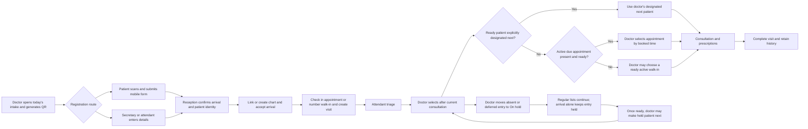

# Software requirements specification

## Purpose and implementation baseline

The application is an internal clinic workspace for a walk-in patient's journey from reception and triage to a doctor's consultation, prescriptions, and medical history. Scheduled appointments share the same encounter workflow after arrival.

This specification distinguishes the intended system from the current demo. The repository contains a React frontend, an initial PostgreSQL schema, and a Docker Compose development stack. The backend is a placeholder. The frontend uses browser `localStorage`; it does not call PostgreSQL, Redis, or an API. The displayed doctor identity is sample content, not an authenticated session.

“Demo” below means a local browser behavior; “schema” means a database representation or constraint tested directly in PostgreSQL; “planned” means acceptance work remains. Passing the automated suite establishes the behaviors it exercises, not completion of the intended EHR.

## Scope and assumptions

- One clinic and one configured doctor are sufficient for the current demo. The database represents multiple staff members and clinicians.
- A walk-in can be a new patient or a returning patient. Registration creates a patient identity; arrival creates a separate visit. Booking alone does not create a completed encounter.
- Scheduled appointments and walk-ins use separate active consultation lists, plus an **On hold** column for deferred entries. Present, ready, due appointments in the active list take priority unless the doctor explicitly designates a ready held patient as next. Held entries never regain priority merely by arriving. A consultation in progress finishes before the next patient starts.
- The doctor generates one shared intake QR for their clinic day, covering both today's booked appointments and walk-ins. It opens today's registration form; it is not a patient-specific appointment invitation, a future booking, or a guaranteed consultation slot.
- Clinic local date determines appointment display and daily queue validity. The future server must configure a clinic timezone; the demo uses the browser's local timezone.
- Patient contact details are optional during staff-assisted registration. The proposed self-registration form requires a contact number; a guardian's number is allowed. Patients without a number or suitable device can register with the secretary or attendant. The demo's same-browser check-in preview collects name, phone, date of birth, sex, and allergy status, then links a local chart and queue ticket.
- Allergy status is explicitly `unknown`, `none`, or `known`. Missing confirmation must never become “no known allergies.”
- This scope covers reception, triage, scheduling, consultation, chart history, and printable prescription drafts. Billing, inventory, laboratory integration, insurance, telemedicine, and electronic pharmacy transmission are outside the initial scope.
- All current fixtures and test records are synthetic. Production use requires the planned access controls, shared persistence, audit, backup, and operational acceptance below. No regulatory compliance is claimed.

## Actors and intended access

| Actor | Intended responsibilities | Restrictions |
| --- | --- | --- |
| Patient / accompanying person | Scan today's doctor-generated QR, submit registration details, receive a private submission reference, and present to reception. | No staff workspace, other patients, chart, or prescription access. A queue token is not staff authentication or identity verification. |
| Attendant / secretary (`attendant_secretary`) | Display the doctor's QR, pause/resume same-day intake, manually register patients, review self-submissions, confirm identity and allergy status, book appointments, check arrivals in, update presence/readiness, record triage, and hand patients to the doctor. | Cannot generate/rotate the doctor's QR, reopen closed intake, release held patients or designate them next, author diagnoses or prescriptions, finalize clinical encounters, or read the doctor's full longitudinal history. |
| Doctor / administrator (`admin_doctor`) | Open/close today's intake, generate/rotate its QR, hold/defer entries, keep held patients waiting or make one next, explicitly resolve held bookings, select from active appointments/walk-ins, review triage and history, start consultation, document assessment, prescribe, complete visits, and manage staff access. | Every action is attributed to the authenticated user; disabled accounts cannot act. |

The role enum exists in the schema. Login, API authorization, staff administration, and enforcement of this table remain planned. Hiding a frontend button is insufficient authorization.

## Intended clinic workflow

1. **Daily intake and arrival.** The doctor opens today's intake and generates its QR. A patient either submits the mobile form or asks reception to enter their details. Both routes use the same intake process described below. Reception confirms physical arrival and identity before checking in a scheduled appointment or issuing a walk-in queue number.
2. **Registration or confirmation.** Record name, date of birth, sex, contact details according to registration route, and explicit allergy status. Known allergies require details. Returning patients retain the same patient number.
3. **Encounter creation.** Create one visit for this arrival. A scheduled arrival references its appointment; a walk-in can have no appointment. Retrying appointment check-in must not create another visit.
4. **Attendant triage.** Record chief complaint, initial notes, and available blood pressure, weight, and temperature. Missing observations remain missing. Confirm the patient and allergy information before marking the visit ready in its appointment or walk-in list.
5. **Doctor handoff.** Finish the current consultation, then honor an eligible patient explicitly designated next by the doctor. Otherwise prioritize present, ready, due appointments in the active list in scheduled-time order. If none is ready, the doctor may choose a ready active walk-in, normally in physical arrival order. An absent/late entry can be moved to **On hold** so the regular lists continue. Arrival or readiness alone never restores a held entry's old priority; the doctor must explicitly choose **Make next** once that patient is ready, or keep them held. Review identity, allergy status, triage, and authorized history before starting. Every placement change records its actor and reason.
6. **Consultation and prescription.** Save interview notes, observed signs, reported symptoms, assessment, and treatment instructions. The doctor can create a prescription attached to the same visit. Review patient identity and allergy information before printing.
7. **Completion and follow-up.** Finalize the encounter, record completion time, update the linked appointment, and place a snapshot of the encounter and its prescriptions in history. Book follow-up if needed. Later draft edits must not alter the saved history.
8. **Exceptions.** Reception can pause new intake through either entry route while continuing existing requests and the accepted line. Invalid, expired, paused, or closed links cannot add requests. Cancelled visits and no-shows remain distinguishable from completed care.

The browser demo now links QR-preview registration, a patient chart, queue ticket, attendant triage, doctor consultation, optional prescription draft, and a saved history summary through one local encounter ID. The QR is explicitly a same-browser preview. This is not shared intake, authenticated role access, a server transaction, appointment check-in, or a finalized clinical record. Legacy queue tickets can still be marked seen as tickets; that status does not mean a visit was completed.

## Proposed daily QR and assisted registration flow

This is the intended shared workflow. The browser demo provides a clearly labeled same-browser preview with a local chart/ticket/triage/visit link; shared mobile intake, staff review, authorization, and server encounter integration below remain planned.

### Confirmed appointment priority and walk-in selection

Scheduled bookings retain their appointment date/time and are separate from the walk-in queue. QR versus staff entry records how registration happened; it does not decide appointment priority. Only a staff-verified, linked appointment places an arrival in the appointment list. Entering a claimed booking reference on the public form does not grant priority. A held booking retains its scheduled classification but is excluded from active appointment selection until the doctor releases it through **Make next**.

The doctor sees **Appointments**, **Walk-ins**, **On hold**, and **In consultation** columns, plus closed records for completed/cancelled/no-show outcomes. Appointments show booked time; walk-ins show their stable daily numbers. On-hold cards retain their original appointment reference or walk-in number, reason, held time, and current presence/readiness. Both registration routes share the same patient, intake, triage, and visit workflow. One active arrival appears in one operational placement at a time; a next designation is one badge/slot, not a second copy of the card.

| Situation when the doctor is free | Selection rule |
| --- | --- |
| A held patient has been explicitly designated next and remains present/ready | Honor that one next consultation before the normal active lists. The designation never interrupts a consultation already in progress. |
| No explicit next designation exists and active due appointments are present/ready | Prioritize those active appointments in booked-time order over waiting active walk-ins. Held appointments do not participate. |
| The due appointment patient is absent, temporarily away, or not yet ready | The doctor may move that entry to **On hold**. Continue with another active due ready appointment, or let the doctor choose a ready walk-in or wait. The system does not call/start someone automatically. |
| Only future appointments exist | Show the next booked time so the doctor can decide whether to take a ready walk-in. A later booking does not block the walk-in queue for the whole day. Seeing a future appointment early requires an explicit doctor selection. |
| An active, non-held appointment patient arrives while a walk-in is being seen | Finish the current consultation, then apply active appointment priority unless an eligible explicit next designation exists. |
| A held appointment patient arrives, including during a consultation | Update presence and clinical preparation while keeping the card held. The doctor can make that ready patient next or keep them waiting; the old booked time does not automatically move them ahead. |
| A booking is cancelled, marked no-show, or rescheduled | Remove it from live selection and retain its outcome/history. A closed booking cannot be made next through the hold action; rescheduling is explicit. |

For this scheduling rule, an appointment becomes due at its booked start time; a patient is ready only after verified arrival and the required clinical preparation. An absent patient does not automatically become a no-show just because the doctor chooses a walk-in. Moving an entry to hold is an explicit nonterminal placement change, not cancellation or automatic rescheduling. Future appointments keep their original booked time; moving an earlier appointment does not pull later bookings forward automatically. Priority is applied between consultations and does not guarantee an exact start time.

Starting any consultation rechecks current presence, readiness, operational placement, explicit next designation, active appointment priority, and whether this doctor already has a consultation in progress. If an active appointment becomes ready while an ordinary walk-in selection is pending, refresh the choice before starting; the doctor's explicit next designation is an attributed exception to the normal ordering. Arrival of a held patient does not invalidate ordinary selection. Once a consultation has started, later changes affect only the next selection.

### Holding, continuing the line, and choosing next

The doctor can move an absent, late, temporarily away, or deliberately deferred active entry to **On hold**, recording a reason. An appointment may be held before arrival and before a visit exists; this changes the booking's operational placement without creating an encounter or claiming the patient checked in. Existing accepted patients retain their patient, arrival, and visit links. Holding never changes the original booked time, arrival timestamp, or walk-in number, and never renumbers the rest of the queue.

While a patient is held, staff can confirm arrival and complete registration/clinical preparation. Those updates do not release the hold. The doctor's actions are:

| Action | Business effect |
| --- | --- |
| **Make next** | Available only when the held patient is present, ready, and not closed. Designate them for the consultation after the current one, overriding the normal appointment/walk-in order for that one selection. An absent patient cannot reserve this slot and block the live line. |
| **Keep waiting** | Leave the patient held without a next designation; normal appointment/walk-in selection continues. |
| **Cancel / mark no-show** | Explicitly close the applicable booking/arrival with its reason and retain the record. For a visit not yet started, update any linked visit consistently. Holding alone never performs this action. |
| **Reschedule** | Explicitly resolve the old booking and create/change the future booking under normal scheduling validation. Do not silently change its time or carry an old same-day queue position into another day. |

There is at most one explicitly designated next patient per doctor. If the doctor chooses a different held patient, show the existing designation and require an explicit replacement; the earlier choice stays/returns on hold with its identity and number intact. The same rule applies when deliberately switching from the held choice back to a normal list. Consuming, clearing, replacing, or cancelling a designation never starts a consultation automatically.

Recheck readiness and closure at consultation start. If the designated patient becomes absent/unready, clear the designation and keep them held; if cancelled/no-show/rescheduled, clear it and retain that terminal/resolved outcome. The regular lists remain available. Failed or repeated actions cannot create duplicate placements, visits, or competing next designations. Record actor, time, reason, and old/new placement for every hold, designation, replacement, release, and disposition.

For example, appointment **A1** is absent and the doctor moves it to **On hold**. **A2** is booked later, so the doctor chooses walk-in **W1**. When A2 becomes due and ready, it has normal appointment priority while A1 remains held. If A1 subsequently arrives, it still does not jump back ahead. The doctor can make ready A1 next, keep it waiting while A2/other ready patients proceed, or explicitly close/reschedule it. W1's consultation always finishes before the next patient begins.

If staff discovers an eligible appointment after accepting someone as a walk-in, link it to the same patient/arrival/visit and change its classification atomically. Retire the walk-in queue placement without reusing its number; preserve the receipt, original arrival time, audit history, and any existing hold. An active arrival moves to the appointment list; a held arrival stays held and still needs the doctor's explicit next decision. Do not create another visit or display the patient in both lists.

### Remaining business rules requiring clinic validation

The appointment-first policy and doctor-controlled hold/next actions above are confirmed. Capacity/cutoff, recording physical arrival before paperwork finishes, and staff clinical handoff still need operational validation. The acceptance-numbering and attendant-handoff defaults later in this document remain provisional for those remaining decisions.

| Area | Real clinic scenario | Proposed rule / decision needed |
| --- | --- | --- |
| Capacity and cutoff | Intake closes with many unverified submissions, or the doctor has no capacity for another walk-in. | Set session hours, walk-in capacity, and an acceptance cutoff. Submission does not reserve capacity. Acceptance checks remaining capacity atomically and distinguishes booked patients from walk-ins. Full capacity requires a clear decline/reschedule or separately agreed waitlist outcome; a queue number must not promise unavailable care. |
| Arrival fairness | An assisted patient takes ten minutes to finish registration while later QR users finish immediately. | Record physical arrival promptly, separately from form completion and verification completion. Preserve that arrival order when the patient becomes eligible; remote submission alone earns no place. The acceptance-numbering default below needs adjustment to use this recorded arrival order before implementation. |
| Reception versus clinical work | A secretary can register patients but no clinical attendant is working that day. | Separate identity/administrative checks from clinical assessment. Confirm which staff can perform each observation and handoff, and allow the doctor to complete necessary clinical preparation. An unavailable attendant must not strand every patient behind a mandatory attendant-only step. |
| Opening, breaks, and doctor absence | Reception opens before the doctor logs in, or the doctor must leave with patients still waiting. | Keep doctor authorization of the day's session. Decide whether generation happens before reception opens or authorized staff may activate a prepared session. Distinguish stopping new intake from stopping consultations; retain waiting records and explicitly resolve affected appointments/visits through continuation, cancellation, or rescheduling. |
| Late-arrival timing and end-of-day review | A held patient remains absent near closing, or returns much later than their booking. | Define any notification/grace/cutoff rules and end-of-day review. Placement is already settled: held patients remain held until the doctor explicitly makes them next or resolves the booking. No fixed grace minutes or automatic no-show is assumed. A lost receipt/duplicate submission does not restart the visit or arrival time. |
| Front-desk workload | A returning patient must repeat a full registration form, or the secretary must retype an entire QR submission. | Reuse confirmed chart details through the authenticated staff workflow and review submitted changes without re-entry. Keep public intake brief and provide assisted completion; determine which fields are necessary before submission versus before clinical handoff. Public identifiers alone still reveal no chart data. |

Validate the chosen rules with a normal clinic day, a fully booked day, a late/no-show appointment, an assisted patient, a skipped patient returning, and an unexpected doctor absence. Each selected rule needs a corresponding acceptance scenario before the shared workflow is treated as ready for implementation. The QR and manual routes must produce equivalent outcomes under each scenario.

### Open today's intake

The authenticated doctor selects **Open today's intake**. The server binds a session to the clinic, doctor, and clinic-local date and returns an opaque QR/link. Reopening the screen returns that same session and QR; opening it again must not clear registrations or start a second line. Staff can display or print it at reception. The landing page shows the clinic, doctor, date, and whether registration is open before asking for details.

The QR is shared across today's patients. It contains no patient identity, appointment details, or medical information. Only the doctor can rotate it or close the session. Staff can pause open intake or resume paused intake; pausing blocks new manual and public submissions without interrupting review or care. Rotation invalidates the earlier QR while preserving requests, visits, and already-issued private references. Closing blocks new intake for the day; reopening a closed same-day session requires the doctor and preserves its records. The QR expires at the next clinic-local date. Existing accepted visits can still finish after intake closes or the date changes.

### Register through either route

| Route | Patient/staff experience | Result |
| --- | --- | --- |
| Patient self-registration | Scan using the phone's camera or open the shared link; no app installation or patient account is required. Enter details, review them, and submit once. An accompanying person may complete the form for the patient and identify their relationship. | A private reference and **Submitted — confirm your arrival at reception** message. No chart, appointment check-in, or doctor-queue position is created yet. |
| Secretary / attendant registration | Choose **Add patient today**, search existing charts first, select a returning patient or enter a new patient's details, and confirm them with the patient. | The same intake request, marked `staff` with the staff author. Staff may submit and accept together once identity and physical arrival are confirmed. |

The proposed form collects the patient's full name, date of birth, sex (including unknown/prefer not to say), contact number, short reason for today's visit, and explicit allergy status with details when known. Email, existing patient number, and today's appointment reference are optional. Contact number is optional in assisted registration. For accompanying-person submissions, patient demographics remain separate from the submitter's name, relationship, and contact. Validation rejects blank required fields, impossible/future birth dates, malformed entered contacts, and known allergies without details. Allergy status is never preselected as `none`.

Returning patients can identify themselves without browsing a patient list. Public pages never reveal chart matches or prefill stored demographics/history from an entered phone, name, patient number, or appointment reference. Patient-entered changes and allergies remain unverified until staff confirmation; they do not overwrite a returning patient's chart automatically. A failed submission retains form input, explains the failure, and does not claim success before server acknowledgment. Resubmission after a lost response uses the original private submission key and returns the original reference and current state without creating anything again.

### Verify, accept, and prepare for the doctor

The secretary/attendant sees **Needs verification** requests with source, submission time, reported appointment reference, and possible identity matches. Staff confirms the patient is present, checks identity using name and date of birth plus available patient/contact details, then selects an existing chart or explicitly creates one after reviewing possible duplicates. Shared phone numbers never imply that two people are the same patient. Ambiguous matches require staff resolution; they must not merge charts automatically.

For a booked patient, staff links the correct active appointment for this doctor and clinic date. Missing or mistyped references do not prevent staff from finding the booking. Appointments on other dates or with another doctor, cancelled/completed appointments, and unresolved `no_show` records cannot be checked in through this flow. A patient without an eligible booking can be explicitly accepted as a walk-in; this creates a visit without inventing a scheduled appointment or time slot.

Acceptance atomically links/creates the patient, marks the request accepted, creates an `in_triage` visit, and either checks in a linked appointment or allocates a unique increasing daily walk-in queue number. A booked patient retains their appointment reference and does not also join the walk-in queue. Staff-assisted and self-submitted arrivals use this same operation. If any step fails, none is reported complete. A repeated acceptance returns the same visit, appointment reference, and applicable walk-in number. If another route already accepted that patient, staff links the request to that active arrival instead of creating another chart, visit, or number. A further visit after completion requires explicit staff confirmation and a recorded reason.

Accepting an arrival for a booking already on hold creates/links its first visit while retaining the hold. Staff registration, appointment check-in, and triage must not release that placement or erase its reason/history.

The attendant confirms demographics and allergy information and records triage. **Ready for doctor** moves the clinical visit to `waiting`; its independent operational placement remains active or held. A held visit can be clinically ready while excluded from normal selection. Submission or acceptance alone does not put an untriaged patient in the doctor's ready list. Apply the confirmed appointment/hold/next policy above. Within the active walk-in list, physical arrival order is the default among ready patients regardless of registration route; earlier patients still being prepared do not block those already ready. A QR scanned or shared remotely cannot reserve a place; its submission time is separate from verified arrival time. A walk-in number identifies that arrival; it does not guarantee an exact consultation rank or time.

The doctor selects and calls a ready patient under the appointment/hold/next policy, confirms identity, starts the consultation, and completes the same visit with its notes/prescriptions. Ordinary ready lists exclude held, in-progress, and terminal entries. Staff presence updates cannot restore a held entry's priority; the doctor explicitly controls release into the next consultation. Any hold, next designation, replacement, cancellation, classification correction, or priority change records actor, time, and reason. Terminal records are retained.

### Patient feedback and exceptions

The patient receipt exposes only that submission's reference, acceptance/placement state (including **On hold** or **Selected next**), and the patient's confirmed appointment time or assigned walk-in number when available, using a separate unguessable receipt credential. Explain that active due ready appointments normally take priority, held patients await the doctor's decision, and an explicit next selection can change the normal order. **Selected next** means after the current consultation, subject to continued presence/readiness. A walk-in number is not a combined consultation rank. The shared QR is insufficient to retrieve a receipt or another patient's details. No public patient roster or clinical records appear. Initial delivery uses the browser receipt; SMS notifications and live wait-time estimates are outside this addition.

Expired, replaced, paused, or closed QR pages explain that registration is unavailable and direct the patient to reception. Both entry routes recheck session state before creating a request; a form opened before a pause or midnight cannot bypass the restriction. Staff can still review and accept existing same-day requests while intake is paused/closed. Creating a new request, including combined manual submission-and-acceptance, requires resuming paused intake or the doctor reopening closed intake. Unaccepted requests expire at the next clinic-local date; a patient returning later needs a new request.

Receipt refresh and replay of an already-saved submission remain available using its original private credential after pause, closure, rotation, or date rollover. Return the original reference with its current state, including `expired` for an unaccepted prior-day request; do not create or accept anything during a replay. Accepted visits and receipts remain accessible independently of the shared QR. Assisted registration remains available for patients who cannot use the public form, subject to the same intake availability rules.

## Lifecycles

| Entity | Intended states and rules | Current representation |
| --- | --- | --- |
| Visit | `in_triage → waiting → in_progress → completed`; cancellation before completion. Terminal records remain in history. Queue, start, and completion timestamps correspond to actual events. | Schema has these states and timestamp fields. No API or UI transition service yet. |
| Appointment | `scheduled → confirmed → checked_in → completed`; cancellation before completion; `no_show` for a missed appointment. A scheduled appointment can be checked in directly. | Demo can create and display appointments. Schema additionally supports `no_show`. Status mutation and visit synchronization are planned. |
| Demo queue ticket | `waiting → called → completed`; at most one ticket is called in the single-doctor demo. Pausing intake does not remove existing tickets. | Browser-only queue; ticket has no patient ID, appointment ID, triage, or clinical record. |
| Daily intake session | `open ↔ paused → closed`; doctor may close from either state and explicitly reopen a closed same-day session. The shared QR expires at the next clinic-local date. Token rotation preserves registrations and accepted visits. | Demo has browser-local open/paused sessions only. Doctor ownership, closed state, clinic timezone, shared server, and synchronization are planned. |
| Intake request | `submitted → accepted / rejected / cancelled / expired`. Acceptance links one patient and visit. Duplicate requests can reference the already-accepted arrival with a duplicate disposition rather than generating another visit. | Planned; separate from the demo's immediately numbered queue ticket. |
| Consultation placement | Active appointment or walk-in entry can move to `on_hold`; a doctor can designate a present/ready held entry as next. Arrival alone leaves it held. Starting moves the same visit into consultation; completed/cancelled/no-show outcomes leave live selection. A held booking may not have a visit yet. | Planned operational metadata, independent of clinical visit and appointment status; at most one explicit next designation per doctor. |

The schema's permitted status values do not themselves enforce every transition, staff role, or cross-entity update. The future API must validate and commit these changes atomically.

## Functional requirements

`QUE-01`–`QUE-03` describe the existing browser queue demo. `INT-01`–`INT-09` define the proposed shared intake workflow, which replaces immediate public ticket allocation with verified appointment check-in or walk-in numbering and visit integration. `APT-05`/`APT-06` define active-list selection, held entries, and explicit next designation.

| ID | Requirement and acceptance condition | Implementation status |
| --- | --- | --- |
| PAT-01 | Search existing patients by case-insensitive name, patient number, or phone before creating a chart; opening a result shows that patient's identity and records. | Demo directory/global search. Duplicate-identity reconciliation is planned. |
| PAT-02 | Register a patient with a nonblank name, valid date of birth no later than today, sex, and explicit allergy status. Contacts are optional; entered email must be syntactically valid. Reject invalid input without creating a chart. | Demo validation; schema represents required demographics. Server validation is planned. |
| PAT-03 | Generate a stable, unique patient ID and human-readable patient number. Reopening a saved chart preserves identity. A cancelled registration creates nothing. | Demo identity/local persistence; schema enforces unique patient number. Shared allocation is planned. |
| ALL-01 | Keep `unknown`, `none`, and `known` distinct. `known` requires nonempty details; `unknown` and `none` carry no allergy list. Display status in the chart and prescribing context. | Demo; schema validates status/list cardinality. Server validation of each allergy entry is planned. |
| APT-01 | Book an existing patient with a date, start time, positive duration, reason, clinician, and initial `scheduled` status. Starting from a chart selects that patient. | Demo, with one sample clinician; schema links patient and clinician. |
| APT-02 | Reject overlap for the same clinician while an appointment is scheduled, confirmed, or checked in. Use half-open intervals: an appointment may start exactly when another ends. Cancelled and completed slots do not block booking. | Demo overlap check and schema exclusion constraint; concurrent booking API is planned. |
| APT-03 | Show appointments for a selected work week or day in local time and open the corresponding patient chart. Preserve existing bookings after validation errors. | Demo. |
| APT-04 | Check an appointment in once, create its visit, and synchronize completion/cancellation without changing another patient's encounter. Reject appointment/visit patient mismatch. | Schema enforces one visit per appointment and matching patient; API and UI workflow are planned. |
| APT-05 | Keep active appointments, active walk-ins, and held entries in separate operational columns. After an in-progress consultation finishes, honor an eligible explicit next designation; otherwise prioritize active present/ready due appointments by booked time. If none is ready, the doctor may choose a ready active walk-in or wait. Recheck placement/readiness before starting; never start automatically or interrupt an existing consultation. | Planned doctor selection UI, server authorization, and atomic consultation-start checks. Held entries are excluded from normal priority even after arrival. |
| APT-06 | The doctor can hold a booking/arrival, keep it waiting, designate one ready held patient next, or explicitly cancel/no-show/reschedule. Preserve original references/numbers, booked time, arrival, and visit. Presence or classification corrections never clear hold. Allow one explicit next designation per doctor; replacement is deliberate and returns the displaced held choice to hold. Clear unavailable/closed choices safely and audit all moves. | Planned. Holding an unarrived booking creates no visit; cancellation is a distinct closed outcome and cannot be reversed through Make next. |
| QUE-01 | Generate today's QR/link and allow intake to pause or reopen. Reject stale-date, unknown-token, and paused check-ins. Regeneration preserves today's entries and invalidates the earlier token. | Demo browser-local session. |
| QUE-02 | Validate a nonblank name, a phone containing a digit, a valid date of birth, sex, and explicit allergy status; known allergies require details. Repeating an active check-in with the same date of birth and equivalent name casing/phone formatting returns the existing ticket. Issue monotonically ordered, zero-padded tickets for new arrivals. | Demo; server idempotency, identity verification, and concurrent allocation are planned. |
| QUE-03 | Move a check-in through triage, ready handoff, consultation, and completion; preserve the queue ticket and linked chart history. Legacy tickets may be marked seen as tickets only. | Demo browser workflow using a shared local encounter ID; not an authenticated or server-backed lifecycle. |
| INT-01 | Only the authenticated doctor opens today's doctor/date intake session and generates/rotates its shared QR. Reopening returns the existing session; rotation invalidates only the old shared link. Staff can display and pause/resume intake; only the doctor closes or reopens a closed session. | Planned; demo token controls are unauthenticated and browser-local. |
| INT-02 | Provide a mobile public form and staff-assisted form with the fields and validation above. Record source, submitter relationship when applicable, and staff author. Manual registration works without a patient phone/device and searches charts before creating one. | Planned shared workflow; the same-browser preview collects name, phone, date of birth, sex, and allergy status and links a local chart/ticket. Staff-assisted chart creation is still independent; server submission review and attributed authors remain absent. |
| INT-03 | Save self-registration as an unverified request and return only its private reference/state. No patient search, chart read/write, appointment check-in, visit creation, or queue reservation is permitted through the shared public QR. | Planned public-request contract. The same-browser demo immediately creates or links a local chart and numbered ticket/encounter; it does not implement an unverified submission inbox or private server receipt. |
| INT-04 | Staff verifies physical arrival and identity, reviews possible duplicate matches, then selects/creates the patient. Public details do not overwrite charts without confirmation. Link only an eligible same-day appointment for this doctor; otherwise explicitly register a walk-in. | Planned; existing appointment/visit constraints cover only part of the data integrity. |
| INT-05 | Accept arrivals through one server transaction for both routes: patient linkage/creation, request acceptance, visit, and either appointment check-in or a daily walk-in number. Retain a linked booking's existing hold on the accepted arrival/visit. Retry returns the original result. Concurrent acceptance of the same identified patient/session yields one active arrival in one operational placement; distinct walk-ins get distinct increasing numbers. Correcting classification links an eligible booking to the same visit without duplicate entries or releasing hold. | Planned; server transaction, idempotency, allocation, and uniqueness constraints are required. |
| INT-06 | Flag likely unverified duplicates using normalized name/date of birth and supporting contacts, without merging automatically or treating shared phones as identity. Once linked, return the existing active arrival across entry routes. Additional same-day visits after completion require explicit staff confirmation and reason. | Planned. Demo name/phone comparison is not patient identity verification. |
| INT-07 | Require clinical preparation/handoff before consultation eligibility. Apply APT-05/06 selection and hold rules; order ready active walk-ins by physical arrival by default. Held patients may be clinically ready while still excluded from normal selection. Hold/next changes preserve original references/numbers and record actor/time/reason. A receipt or number alone cannot start a consultation. | Planned server eligibility, priority/hold rules, and attributed handoff. The local demo already links queue registration, triage, ready handoff, consultation, and history; clinical staff assignment/handoff details remain subject to clinic validation. |
| INT-08 | Reject creation of new requests through either route when intake is paused, closed, or expired, and reject new public requests using a rotated token. Staff may review/accept existing same-day requests while paused/closed. Private retries of saved submissions return the original reference/current state even after rotation or expiry. Expire unaccepted prior-day requests; preserve accepted visits/receipts. | Planned; state/date revalidation is server-side. Token rotation affects new public requests, not existing requests or authenticated assisted registration. |
| INT-09 | A phone submission appears in the staff inbox across devices after server acknowledgment. Its separate private receipt shows only its reference, acceptance/placement state, and applicable confirmed appointment time or walk-in number; use an unguessable credential, encrypted transport, submission throttling, and payload limits. Unauthorized hold/release actions and receipt enumeration are rejected server-side. | Planned; browser storage cannot support shared-device operation or authorization. |
| TRI-01 | Record complaint, initial notes, and optional observations against the linked demo encounter; require explicit identity review before handoff. | Demo attendant handoff and encounter linkage; no server validation, attributed staff identity, or clinical safety guarantee. The schema numeric range is not clinical advice. |
| VIS-01 | Retain saved interview drafts under their patient. Switching patients must not transfer unsaved signs, symptoms, prescription fields, or print previews to the other chart. | Demo clears transient form state on patient change; durable encounter-wide and cross-device drafts are planned. |
| VIS-02 | Save a nonempty encounter summary containing the interview-note snapshot, signs, symptoms, and diagnosis entered by the user. Reject a completely blank summary; later draft edits preserve the earlier saved content. | Demo summary/history; structured visits, authorship, and finalization are planned. |
| VIS-03 | Complete a doctor consultation for the linked demo queue encounter; save the note and optional prescription draft under that patient and encounter. Appointment synchronization and transaction guarantees remain required for the real workflow. | Demo browser journey and encounter ID linkage; server timestamps, atomic updates, and appointment synchronization are planned. |
| RX-01 | Add an optional prescription draft during consultation, linked to that same demo encounter; preserve entered details and label any print preview as a demo draft with sample clinician identity. | Demo; authenticated authoring and finalization are planned. |
| RX-02 | Only an authorized doctor can issue/finalize a prescription, linked to the correct encounter and author. Clinician review is required; no automatic medication selection or allergy-interaction guarantee is provided. | Planned API and prescribing validation. The demo prints a draft with a sample doctor identity. |
| HIS-01 | Keep patient histories isolated. Show completed encounter snapshots in reverse chronological order, including triage, assessment, notes, author, timestamps, and prescriptions. Preserve historical content when a new draft is saved. | Demo summary timeline and schema history view each cover part; unified, authorized history is planned. |
| SEC-01 | Authenticate staff and authorize every API read/write by role and patient/encounter context. Unauthenticated check-in can access only its limited ticket information. Disabled accounts lose access. | Planned; schema role and active-account fields only. |
| AUD-01 | Record who read or changed protected records, what action occurred, when, and which patient/visit was affected. Corrections retain prior content and reason. | Planned; `created_at`/`updated_at` columns are not an audit trail. |
| DAT-01 | Reject malformed stored data safely, preserve compatible legacy demo records, and explain a failed browser save without reporting successful durable storage. Refresh restores valid saved demo records. | Demo recovery/persistence; durable server acknowledgments and conflict handling are planned. |
| DAT-03 | Restore the synthetic Philippine demo patients, appointments, and empty queue to a repeatable starting state on explicit user action. | Demo reset control; all sample records remain browser-local. |

## Data and integrity requirements

The intended relationships are `patient → appointments`, `patient → visits`, and `visit → prescriptions`. A visit can reference one appointment; an appointment can be associated with at most one visit, and its patient must match the visit's patient. Staff authorship references users. Deleting referenced patients, visits with prescriptions, or clinicians must not silently erase medical history. Deleting an appointment can detach it from a retained visit without deleting the visit or its patient.

The proposed addition introduces `daily_intake_session → intake_requests` and accepted-request links to patient, visit, and optional appointment. Persist clinic timezone/date, doctor, session state, token version, source, submitter/staff author, reported details, submission/physical-arrival/verification times, disposition, receipt credential digest, and idempotency key. A verified appointment link determines appointment classification; otherwise the visit is a walk-in with a stable daily number. Source (`self`/`staff`) is independent of that classification. Persist operational placement, hold reason/time/author, original ordering values, and next designation separately from presence, clinical readiness, and booking/visit state. A held unarrived booking references the appointment without inventing an intake/visit. Enforce one session per clinic/doctor/local date, unique walk-in numbers within that session, at most one active arrival per identified patient/session across all live placements, one explicit next designation per doctor, and one consultation in progress per doctor. Hold/release/cancellation, next-slot replacement, and consultation start require atomic updates with attributed history. Persist an explicit authorization/reason for a further same-day visit. These intake/placement entities, selection constraints, and migrations do not yet exist in `db/init.sql`.

Database constraints are a final line of data validation, in addition to server checks. Regression coverage must exercise valid inserts as well as expected failures for foreign keys, statuses, allergy consistency, positive appointment duration, same-clinician overlap, triage ranges, prescription JSON shape, and completed-history aggregation. Tests run against a disposable database and roll back their fixtures.

Frontend IDs and date strings are demo representations. A future API contract must define UUIDs, clinic timezone conversion, numeric units, nullability, medication-item shape, validation errors, and pagination before connecting the UI. The existing SQL is initialization for a new volume, not an upgrade migration; changed constraints need a versioned migration before use with existing deployments.

## Nonfunctional and delivery requirements

| ID | Acceptance target | Current boundary |
| --- | --- | --- |
| NFR-01 | Registration, search, scheduling, queue controls, and chart forms support keyboard use, meaningful labels, focus visibility, and readable validation feedback on desktop and narrow screens. | Automated interaction tests cover selected behavior; a full accessibility audit remains required. |
| NFR-02 | Patient/visit/appointment updates are atomic and safe under simultaneous staff or patient requests. Retry a successful request without duplicate arrivals or prescriptions; detect stale edits. | Planned server behavior. Browser storage cannot provide distributed consistency. |
| NFR-03 | Encrypt production transport, protect secrets outside source control, apply least privilege, and define session expiry, access revocation, retention, and data export policies before real use. | Planned operational acceptance; no jurisdiction-specific compliance assertion. |
| NFR-04 | Define and rehearse database backup/restore, recovery objectives, monitoring, and incident procedures before deployment with real records. A restore exercise must verify patient/visit/prescription links. | Planned. Docker volumes alone are not backups. |
| NFR-05 | Lock dependency versions, install reproducibly, type-check, run unit/component tests, test PostgreSQL constraints, exercise built browser workflows, and smoke-test the delivery artifact on each pull request and main-branch push. Any failed required check blocks delivery. | CI acceptance for this change; exact commands are in the README and workflow. |
| NFR-06 | Deliver only a tested frontend build with traceable revision. Publish the frontend container to GHCR only from a successful main-branch push after all checks pass. Deployment requires a configured environment and secure backend. | Continuous delivery of the demo frontend; no live deployment or clinical production environment is configured. |

Performance and recovery budgets require clinic workload and hosting decisions. Until those are agreed, no unsupported throughput, uptime, or recovery guarantee is claimed.

## Acceptance scenarios and regression coverage

1. **New walk-in:** submit valid demographics and a known allergy; exactly one chart opens, allergy details are visible, and refreshing retains the patient. Repeat with unknown status and verify it is not rendered as no known allergies.
2. **Invalid registration:** attempt a blank name, future birth date, missing sex/status, and known status without details. The chart count remains unchanged; cancel also leaves no record.
3. **Chart-specific booking:** open a returning patient's chart and choose Schedule. That patient is selected. Reject an overlapping booking, accept an adjacent slot, and retain both existing and newly accepted appointments after reload.
4. **Daily intake:** generate a queue, join through its preview, resubmit equivalent name/phone details, and verify a single active ticket. A second patient receives the next number.
5. **Paused/invalid intake:** pause check-in and attempt to join; neither a ticket nor a medical chart is created. Unknown, rotated, and prior-day tokens also fail. Reopening allows a new arrival.
6. **Connected visit:** check in a synthetic patient, record triage and explicit identity review, hand off to the doctor, save a consultation and optional prescription draft, and verify note, triage, and prescription share the same encounter ID in that patient's history. The demo remains local to one browser.
7. **Clinical snapshot:** enter interview notes, signs, symptoms, and assessment; save and inspect history. Modify the next draft and verify the saved interview note remains unchanged. A wholly blank summary is rejected.
8. **Patient isolation:** begin a note or prescription for patient A, switch to patient B, and verify no draft or print preview from A appears under B. Saving in B leaves A's history unchanged.
9. **Prescription:** save a consultation-linked optional prescription draft and verify a print preview says DEMO DRAFT and identifies the sample clinician. This is not authorized electronic prescribing.
10. **Demo reset:** change demo data, reset, and verify the same synthetic Philippine patients and appointments return with an empty queue.
11. **Persistence and database regression:** load malformed or incompatible browser records and fail a storage write; the app remains usable and shows when changes cannot be persisted. Separately initialize an empty PostgreSQL database, execute valid workflow fixtures, and assert expected constraint failures. Verify completed history includes only completed visits and preserves all linked prescriptions without duplicate visit rows.
12. **Delivery:** run all required CI jobs, build the delivery artifact, serve it, and exercise the built app. Introduce a failing test and confirm the delivery job depends on all test jobs before releasing artifacts.

### Planned acceptance for the added intake flow

These scenarios describe the intended `INT-01`–`INT-09` and `APT-05`/`APT-06` behavior; they are not covered by the existing demo tests.

13. **Doctor opens the day:** generate today's QR as the doctor, reopen the screen, and retain the same session/link. Staff can display/pause it but cannot generate/rotate/close it. Rotation invalidates the old shared link while accepted receipts and arrivals remain usable. Verify each restriction through the API as well as the UI.
14. **Patient registers by phone:** scan on a second device, review the doctor's name/date, submit valid demographics, complaint, and explicit allergy status, and receive a private reference. Staff sees one pending request. No chart, visit, checked-in appointment, or ready-queue entry exists before staff acceptance. Entering another patient's identifiers never reveals stored data.
15. **Staff-assisted arrival:** register a patient without a phone and an existing patient with a shared family phone. Confirm arrival, select the correct chart or explicitly create one, and accept. Both manual and QR routes produce one linked `in_triage` visit classified as appointment or walk-in, retaining any pre-existing hold instead of activating a held booking. Confirm an accompanying person's details never replace the patient's demographics.
16. **Appointment arrival:** accept a verified patient for today's appointment and check in exactly that appointment once. Reject a mismatched doctor/date/patient and cancelled/completed/no-show booking. A corrected booking lookup works without the patient's reference. Explicit walk-in acceptance creates no scheduled booking.
17. **Retries, matches, and concurrency:** lose a submission/acceptance response and retry, including private replay after pause/closure/rotation; return the original result/current state without a new request or visit. Accept the same patient concurrently through staff and QR requests, and accept different patients simultaneously. Assert one active arrival per identified patient across both lists, no partial chart/appointment updates, stable unique walk-in numbers, and no automatic merge for similar names or a shared phone. A second visit after completion requires a recorded staff reason.
18. **Triage and ready order:** let an earlier active walk-in remain in triage while a later active walk-in becomes ready. Only the ready patient can be called. When both are ready and no explicit next designation or active due ready appointment exists, default to physical arrival order. Hold a walk-in without renumbering the line; arrival/readiness updates leave it held until the doctor's explicit next decision. Complete the same linked visit. A remote submission alone gains no queue position. Appointment/held selection follows scenarios 20–27.
19. **Closure, dates, and privacy:** pause/close intake while forms are open and reject new requests from both routes; allow review/acceptance of already-submitted same-day requests and continuation of accepted visits. At clinic-local midnight expire the old QR and unaccepted requests, even when the phone timezone differs; private replay returns the original expired reference. Reject invalid receipt credentials and attempts to read another submission; verify rate/payload limits and server-side role checks.
20. **Appointment before walk-in:** a walk-in arrived earlier, but an active due appointment is present and ready when the doctor becomes free, with no explicit held-next choice. Prioritize the appointment, retaining the walk-in's number. With multiple active due ready appointments, use booked-time order. Future bookings remain visible without blocking all walk-ins. Verify equivalent classification for QR/manual registration; a self-claimed reference alone does not grant appointment priority.
21. **Absent appointment and held column:** A1 is due but absent. The doctor moves it to On hold; verify its reference/time remain unchanged and no encounter is created before arrival. A2 is booked later and W1 is ready. The doctor can choose W1 or wait; neither choice starts automatically, closes A1, or shifts A2's booked time. The regular lists remain usable while A1 stays held.
22. **Arrival during walk-in consultation:** while W1 is in consultation, held A1 arrives and becomes ready. Keep A1 held and leave W1's consultation unchanged. If active A2 becomes due and ready, A2 retains normal priority over waiting walk-ins; A1 does not jump ahead automatically. In a separate case, an active non-held appointment arriving before an ordinary walk-in starts causes a selection refresh. Concurrent starts never create two consultations in progress.
23. **Late arrival and classification correction:** retain a late booking's scheduled classification and any existing hold. Closed/no-show bookings need explicit resolution. Discover an eligible booking after walk-in acceptance and link it to the same visit, retiring its walk-in placement without reusing the number. Keep one receipt, original arrival time, and live placement. A held classification correction stays held rather than regaining priority.
24. **Make next or keep waiting:** with ready A1 held and active ready A2 waiting, choose Keep waiting and verify normal A2 selection continues. Then explicitly make ready held A1 next and verify that single designation overrides the normal order after the current consultation; no current visit is interrupted. Prevent Make next while A1 is absent/unready or closed, and reject a secretary attempting to release the hold directly.
25. **Replacing next and concurrent actions:** designate held A1 next, then explicitly replace it with held A3. Keep A1 held and preserve both references/numbers. Race two next-designation requests and assert one committed choice with a visible conflict/refresh for stale edits, without silent last-write replacement or duplicate cards. Retry the committed action without another visit, designation, or ordering change.
26. **Unavailable or cancelled next patient:** designate a ready held patient next, then mark them temporarily absent/unready before start. Clear the designation, leave them held, and continue offering normal selection. Repeat with explicit cancellation/no-show/rescheduling; clear next and retain the resolved outcome rather than returning a closed record to the live line. Arrival alone cannot reactivate a closed booking.
27. **Stable line and cancellation integrity:** hold/cancel W1 and verify W2's number and relative order do not change. Holding an unarrived appointment creates no visit; cancelling it updates the booking only. Cancelling an accepted visit before consultation updates its linked appointment/placement consistently. Keep all move/reason/author history and prevent queue actions from silently cancelling a consultation already in progress.

The remaining full-system scenarios—staff login, attendant permissions, triage handoff, atomic arrival/visit creation, multi-device queue, doctor-only history, finalization, audit, backup recovery, and concurrent conflict handling—must receive API/integration and browser tests when those capabilities are implemented. They are not satisfied by mocked component tests or direct schema tests.

### Traceability

| Requirement group | Automated evidence | What the evidence does not establish |
| --- | --- | --- |
| PAT, ALL, APT, QUE, TRI, VIS, RX, HIS, DAT demo behavior | [`frontend/src/clinic.test.ts`](../frontend/src/clinic.test.ts), [`frontend/src/App.test.tsx`](../frontend/src/App.test.tsx), and desktop/mobile Chromium journeys in [`frontend/e2e/clinic.spec.ts`](../frontend/e2e/clinic.spec.ts). | Shared-device operation, authentication, backend atomicity, authenticated author identity, or medical correctness. |
| Database representation and constraints for ALL, APT, TRI, VIS, RX, HIS | [`db/tests/regression.sql`](../db/tests/regression.sql), executed against [`db/init.sql`](../db/init.sql). | API authorization, allowed transition sequence, atomic cross-entity updates, or migrations. |
| NFR-05 and NFR-06 | [`.github/workflows/ci.yml`](../.github/workflows/ci.yml), frontend build, and container/Compose smoke tests. | A secure production environment or readiness to handle real patient data. |
| SEC, AUD, server portions of DAT, NFR-02–04 | Planned tests accompanying future implementation. | These remain unmet release requirements. |
| INT-01–09 daily QR, public/assisted registration, verification, and unified arrival | Planned multi-device browser journeys, API role/idempotency/concurrency tests, and database/migration tests for scenarios 13–27. | Existing QUE demo tests do not establish any shared intake, authorization, or encounter integration. |
| APT-05/06 active appointment priority, held column, and explicit next selection | Planned unit tests for selection/placement rules, API/browser tests for scenarios 20–27, and concurrency checks for competing next/consultation starts. | Existing appointment display and QUE tests do not establish hold/release behavior, doctor choice, or non-interruption of consultations. |

## Remaining product decisions

The requested workflow includes daily doctor-generated QR, patient/staff registration, separate active appointment/walk-in lists, an On hold column, and the doctor's explicit Make next / Keep waiting / disposition actions. Active due ready appointments normally take priority; held entries stay excluded even after arrival unless the doctor designates one next. One explicit next choice overrides normal ordering for the next consultation without interrupting current care. Holding preserves original identity/order values while the regular lists continue. One shared QR per doctor/day and staff review before chart creation remain proposed defaults. Confirm clinic hours/weekend scheduling, timezone, multiple-doctor assignment, grace/notification/end-of-day timing, capacity cutoffs, physical-arrival recording before paperwork finishes, triage staffing/handoff, cancellation/reopening rules, prescription finalization fields, staff history access, duplicate patient reconciliation, and record retention before implementing the backend contract.
